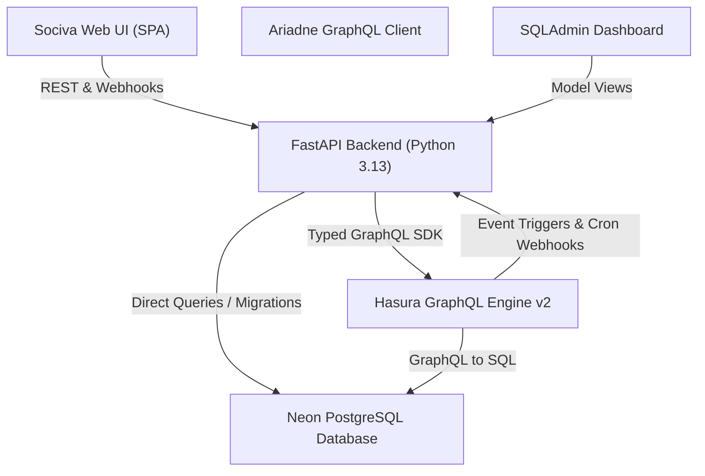

<div align="center">

  

  # Sociva

  **Modern, High-Performance Social Media Platform & Instagram Clone**  
  *Powered by FastAPI, PostgreSQL, Hasura GraphQL Engine, and an Event-Driven Architecture.*

  [](https://www.python.org/)
  [](https://fastapi.tiangolo.com/)
  [](https://hasura.io/)
  [](https://neon.tech/)
  [](https://socialmedia-fastapi-yx0y.onrender.com/)

  ---

  [Live Demo](https://socialmedia-fastapi-yx0y.onrender.com/) • [Interactive API Docs (Swagger)](https://socialmedia-fastapi-yx0y.onrender.com/docs) • [ReDoc](https://socialmedia-fastapi-yx0y.onrender.com/redoc) • [SQLAdmin Dashboard](https://socialmedia-fastapi-yx0y.onrender.com/admin)

</div>

<br/>

## 🌟 Overview

**Sociva** is a full-featured Instagram-inspired social media platform engineered with modern asynchronous Python, high-concurrency GraphQL queries, and an event-driven webhook pipeline. It features an interactive single-page application (SPA) with a sleek dark-mode aesthetic, dynamic micro-animations, real-time activity toasts, threaded comments, scheduled publishing, and 24-hour ephemeral stories.

---

## 🎨 Brand Design & Identity

Sociva features a custom glassmorphic UI built with a signature neon-gradient identity:

| Swatch | Color | HEX Code | Usage |
|:---:|:---|:---:|:---|
| 🟣 | **Violet** | `#7C3AED` | Primary brand color, glowing borders, active states |
| 🪻 | **Magenta** | `#C026D3` | Gradient midtones, highlights, badge accents |
| 🌸 | **Pink** | `#EC4899` | Heart reactions, likes, badge pulses |
| 🍊 | **Coral Orange** | `#FF7043` | Call-to-action buttons, vibrant gradient endpoints |
| 🌑 | **Midnight Black** | `#10101A` | Main background, ultra-dark card backdrops |
| ⚪ | **Clean White** | `#FFFFFF` | High-contrast typography & crisp SVG icons |

**Brand Gradient**: `linear-gradient(135deg, #7C3AED 0%, #C026D3 35%, #EC4899 70%, #FF7043 100%)`

---

## ✨ Key Features

### 👤 User Discovery & Profile Switching
- Multi-user switcher enabling seamless testing of peer-to-peer interactions without logging in and out.
- Real-time user search with debounced backend filtering (`/users/search/?name=`).
- Profile view showcasing user bio, follower stats, post grid, and friendship status.

### 👥 Friendship & Social Graph
- Asymmetric friend request workflow (`pending` ➔ `accepted` / `blocked`).
- Mutual friends detection and incoming pending request notification badge.
- Instant friend request response with real-time UI updates.

### 📸 Feed, Posts & Post Composer
- Image and video post sharing with rich captions.
- Paginated timeline feed displaying friends' updates.
- Interactive engagement: like counter with heart micro-animations.

### 💬 Threaded Comments & Nested Replies
- Multi-level hierarchical comment discussions on any post.
- Reply directly to parent comments with nested indentation.
- Author-level comment deletion.

### ⏱️ Ephemeral 24-Hour Stories
- Instagram-style ring-accented story tray on the home feed.
- Modal story viewer with progress countdown bar.
- Automatic 24-hour expiration (`expires_at`) guaranteed at both the database and service layer.
- Friends-only story filtering so users only see stories from their social circle.

### ⚡ Event-Driven Webhooks & Hasura Integration
- **Hasura Event Trigger**: Instant webhook triggers on friend request creation (`/webhooks/events/friend-request`).
- **Hasura Scheduled Events**: One-off future post publishing (`/posts/schedule` ➔ `/webhooks/events/scheduled-post`).
- **Hasura Cron Trigger**: Automated hourly background cleanup of expired stories (`/webhooks/cron/cleanup-stories`).

### 🛡️ Built-in Admin & Documentation
- **SQLAdmin Dashboard** (`/admin`): Visual GUI for database management (Users, Posts, Comments, Stories, Friendships).
- **Auto-generated API Docs**: Interactive Swagger UI (`/docs`) and ReDoc (`/redoc`).

---

## 🏗️ Architecture & Tech Stack



- **Backend**: [FastAPI](https://fastapi.tiangolo.com/), [SQLModel](https://sqlmodel.tiangolo.com/), [Pydantic v2](https://docs.pydantic.dev/), [HTTPX](https://www.python-httpx.org/), [Uvicorn](https://www.uvicorn.org/)
- **Database**: [Neon.tech](https://neon.tech/) Serverless PostgreSQL with SSL connection pooling
- **GraphQL Engine**: [Hasura GraphQL Engine v2](https://hasura.io/) with Event Triggers and Cron Triggers
- **Code Generation**: [Ariadne Codegen](https://github.com/mirumee/ariadne-codegen) for auto-generating type-safe Python GraphQL clients
- **Admin**: [SQLAdmin](https://aminalaee.dev/sqladmin/) for visual model inspection
- **Frontend**: Vanilla HTML5, modern CSS3 (Custom Design System, CSS Variables, Glassmorphism), and Vanilla ES6+ JavaScript

---

## 📁 Repository Structure

```text
socialmedia-fastapi/
├── main.py                     # Application entry point, CORS, routes & SQLAdmin
├── codegen.py                  # CLI runner for GraphQL client code generation
├── schema.sql                  # PostgreSQL DDL table schemas & recommended indexes
├── config.yaml                 # Hasura CLI configuration (version 3)
├── pyproject.toml              # Project dependencies & entry points ([project.scripts])
├── render.yaml                 # Infrastructure-as-code deployment blueprint for Render
├── .env.example                # Template of required environment variables
│
├── core/
│   ├── config.py               # Pydantic BaseSettings configuration
│   └── database.py             # SQLModel engine & session generator
│
├── models/                     # SQLModel ORM entities
│   ├── user.py
│   ├── post.py
│   ├── comment.py
│   ├── story.py
│   └── friend.py
│
├── routes/                     # FastAPI route handlers
│   ├── user_route.py           # User management, friends & search
│   ├── post_route.py           # Feed, posts, scheduler & comments
│   ├── story_route.py          # 24h stories create, view & delete
│   └── webhook_route.py        # Hasura Event, Cron & Scheduled Event handlers
│
├── services/                   # Business logic layer
│   ├── user_service.py
│   ├── post_service.py
│   ├── comment_service.py
│   ├── story_service.py
│   └── scheduler_service.py
│
├── hasura/                     # Hasura GraphQL queries, mutations & codegen
│   ├── codegen.py              # Ariadne codegen engine
│   ├── users.graphql           # User queries & mutations
│   ├── posts.graphql           # Post queries & mutations
│   ├── comments.graphql        # Comment & reply operations
│   ├── stories.graphql         # Ephemeral story operations
│   ├── friends.graphql         # Social graph operations
│   └── hasura_client/          # Auto-generated typed Python GraphQL client
│
├── metadata/                   # Hasura metadata directory (sources, triggers, tables)
├── static/                     # Brand assets (sociva_logo.png)
└── views/                      # Modern single-page web application
    ├── index.html              # Responsive app markup
    ├── index.css               # Design system, tokens, gradients & animations
    └── app.js                  # Frontend state store, views & API integrations
```

---

## 🚀 Getting Started

### 1. Prerequisites
- **Python**: `>= 3.13`
- **Package Manager**: [uv](https://docs.astral.sh/uv/) (recommended) or standard `pip`
- **PostgreSQL**: Local instance or free cloud database at [Neon.tech](https://neon.tech)
- **Hasura GraphQL Engine**: Hasura Cloud instance or Docker container

### 2. Clone the Repository
```bash
git clone https://github.com/jyotiprakash-m/socialmedia-fastapi.git
cd socialmedia-fastapi
```

### 3. Configure Environment Variables
Copy `.env.example` to `.env`:
```bash
cp .env.example .env
```
Fill in the credentials in `.env`:
```ini
DATABASE_URL="postgresql://<user>:<password>@<host>/<database>?sslmode=require"
HASURA_GRAPHQL_URL="https://<your-hasura-app>.hasura.app/v1/graphql"
HASURA_ADMIN_SECRET="your-hasura-admin-secret"
HASURA_GRAPHQL_ENDPOINT="https://<your-hasura-app>.hasura.app"
HASURA_GRAPHQL_ADMIN_SECRET="your-hasura-admin-secret"
WEBHOOK_SECRET="super-secret-hasura-key-2026"
API_BASE_URL="http://localhost:8000"
```

### 4. Install Dependencies
Using `uv`:
```bash
uv sync
```
Or using standard `pip`:
```bash
python -m venv .venv
source .venv/bin/activate
pip install -r requirements.txt
```

### 5. Initialize the Database
Execute [`schema.sql`](schema.sql) in your PostgreSQL database (e.g. via Neon SQL Editor, psql, or Hasura SQL console):
```bash
psql "$DATABASE_URL" -f schema.sql
```

### 6. Synchronize Hasura & Generate GraphQL Client
```bash
# Reload Hasura schema cache from PostgreSQL
hasura metadata reload --envfile .env

# Generate typed Python GraphQL client from Hasura
uv run codegen
```

### 7. Run the Application
```bash
uv run uvicorn main:app --reload --port 8000
```
Open your browser at:
- **Sociva App**: `http://localhost:8000/` or `http://localhost:8000/views/index.html`
- **Interactive Swagger Docs**: `http://localhost:8000/docs`
- **SQLAdmin Panel**: `http://localhost:8000/admin`

---

## 📡 API Reference Overview

### Users (`/users`)
| Method | Endpoint | Description |
|:---:|:---|:---|
| `GET` | `/users/` | List all users (supports pagination `skip`, `limit`) |
| `GET` | `/users/{id}` | Get user by ID |
| `POST` | `/users/` | Create a new user |
| `PUT` | `/users/{id}` | Update existing user details |
| `DELETE` | `/users/{id}` | Delete a user |
| `GET` | `/users/search/?name=` | Search users by name |
| `GET` | `/users/{id}/friends` | List accepted friends for a user |
| `GET` | `/users/{id}/friend-requests/pending` | List pending friend requests |
| `POST` | `/users/{id}/friends/request/{friend_id}` | Send a friend request |
| `POST` | `/users/{id}/friends/accept/{friend_id}` | Accept incoming friend request |
| `POST` | `/users/{id}/friends/reject/{friend_id}` | Reject incoming friend request |
| `DELETE` | `/users/{id}/friends/{friend_id}` | Remove a friend connection |

### Posts & Comments (`/posts`)
| Method | Endpoint | Description |
|:---:|:---|:---|
| `GET` | `/posts/` | Get timeline feed with user & comment details |
| `GET` | `/posts/{id}` | Get single post by ID |
| `POST` | `/posts/` | Publish a new image or video post |
| `POST` | `/posts/schedule` | Schedule post for future release via Hasura Event |
| `GET` | `/posts/user/{user_id}` | Get all posts authored by a user |
| `DELETE` | `/posts/{id}` | Delete a post |
| `POST` | `/posts/{id}/comments` | Add a comment to a post |
| `GET` | `/posts/{id}/comments` | Retrieve comments for a post |
| `POST` | `/posts/comments/{id}/replies` | Add a threaded reply to a comment |
| `GET` | `/posts/comments/{id}/replies` | Retrieve replies for a comment |
| `DELETE` | `/posts/comments/{id}` | Delete a comment |

### Stories (`/stories`)
| Method | Endpoint | Description |
|:---:|:---|:---|
| `POST` | `/stories/` | Post a story (24-hour expiration) |
| `GET` | `/stories/user/{user_id}` | Get active non-expired stories from user & friends |
| `GET` | `/stories/{id}` | Get story details |
| `DELETE` | `/stories/{id}` | Delete an active story |

### Hasura Webhooks (`/webhooks`)
| Method | Endpoint | Trigger Source |
|:---:|:---|:---|
| `POST` | `/webhooks/events/friend-request` | Hasura Event Trigger on `friend` INSERT |
| `POST` | `/webhooks/events/friend-status-updated` | Hasura Event Trigger on `friend` status UPDATE |
| `POST` | `/webhooks/events/scheduled-post` | Hasura Scheduled Event callback |
| `POST` | `/webhooks/cron/cleanup-stories` | Hasura Cron Trigger hourly cleanup |

---

## 🔄 Hasura Synchronization Workflow

When making database schema updates:

```bash
# 1. Apply your ALTER TABLE or DDL in PostgreSQL
# 2. Reload Hasura metadata so it catches column & default changes:
hasura metadata reload --envfile .env

# 3. Export latest metadata to version control:
hasura metadata export --envfile .env

# 4. Re-run client codegen to sync Python models:
uv run codegen
```

---

## 🚢 Deployment (Render)

This application is ready for zero-downtime deployment on [Render](https://render.com) using the included [`render.yaml`](render.yaml):

1. Link your GitHub repository to Render.
2. Render automatically detects the `render.yaml` blueprint.
3. Configure your production environment variables (`DATABASE_URL`, `HASURA_GRAPHQL_URL`, `HASURA_ADMIN_SECRET`, `WEBHOOK_SECRET`).
4. Build command: `pip install -r requirements.txt && python codegen.py`
5. Start command: `uvicorn main:app --host 0.0.0.0 --port $PORT`

---

## 🤝 Contributing

1. Fork the Project
2. Create your Feature Branch (`git checkout -b feature/AmazingFeature`)
3. Commit your Changes (`git commit -m 'Add some AmazingFeature'`)
4. Push to the Branch (`git push origin feature/AmazingFeature`)
5. Open a Pull Request

---

## 📄 License

This project is licensed under the [MIT License](LICENSE).
